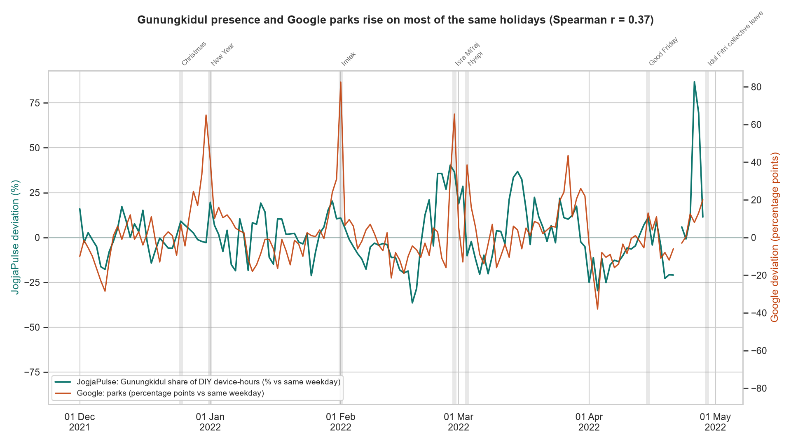
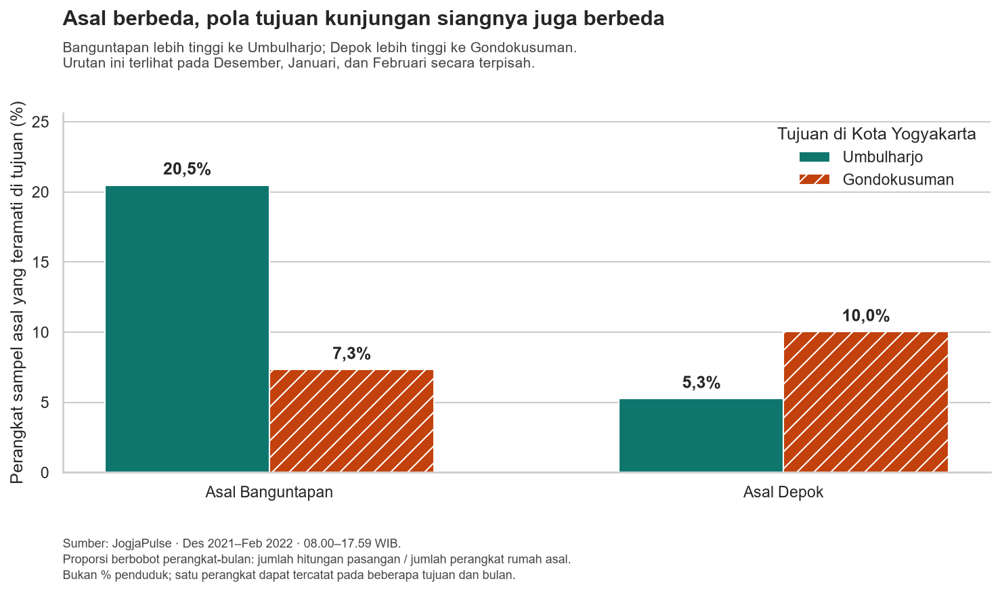
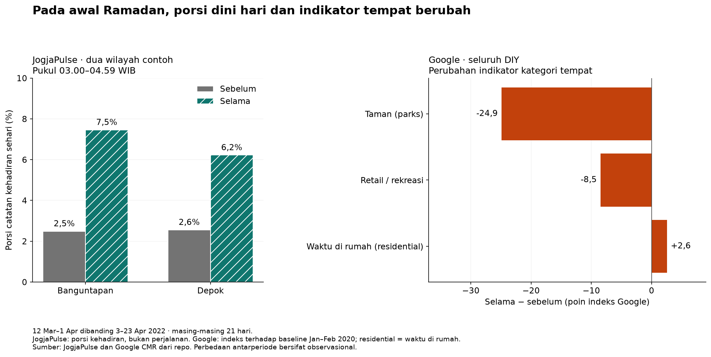

# Human Mobility di Yogyakarta — panduan hasil dan presentasi

Branch `codex/output-2-analytics` berfokus pada dua analisis: **kunjungan siang** dan **Ramadan**. README ini menjelaskan cerita yang dibawa, grafik yang ditampilkan, serta batas kesimpulannya. Angka dan pemeriksaan lengkap tetap tersedia di notebook.

## 1. Cerita proyek dalam bahasa sederhana

Kami memakai dua sumber data ponsel untuk memahami pola mobilitas di DIY. JogjaPulse memberi rincian kehadiran perangkat menurut wilayah dan waktu, sedangkan Google memberikan indikator kategori tempat untuk seluruh DIY.

Pada output pertama, beberapa indikator kedua sumber bergerak searah, tetapi kesesuaiannya terbatas. Karena itu, hasil berikut dibaca sebagai pola pada sampel yang teramati, dengan pemeriksaan tersendiri untuk setiap analisis.

Pada **kunjungan siang**, perangkat yang diperkirakan berumah di Banguntapan mempunyai tujuan Kota teratas di Umbulharjo. Untuk asal Depok, tujuan teratasnya Gondokusuman. Urutan tersebut terlihat pada **Desember 2021, Januari 2022, dan Februari 2022**. Jadi, dua asal ini memperlihatkan hubungan dengan bagian Kota yang berbeda.

Pada **Ramadan**, porsi pencatatan dini hari lebih tinggi di Banguntapan dan Depok. Pada periode yang sama, indikator Google DIY untuk taman dan retail/rekreasi lebih rendah, sedangkan waktu di rumah lebih tinggi. Temuan tersebut memberi gambaran tentang waktu pencatatan dan kategori tempat; penyebabnya belum dipastikan.

**Kesimpulan bersama:** data memperlihatkan pola ruang dan waktu. Asal wilayah berkaitan dengan tujuan siang yang berbeda, sementara pola pencatatan selama awal Ramadan berbeda dari periode sebelumnya. Hasilnya membantu memilih hubungan wilayah, jam, dan kategori tempat yang layak ditelusuri lebih lanjut.

## 2. Grafik yang ditampilkan saat presentasi

Cukup tiga grafik utama untuk seluruh alur. Dua grafik terakhir adalah hasil utama branch ini. Tabel kecil di README membantu memahami angka; tidak semuanya harus ditampilkan dalam video.

| Urutan | Grafik | Pesan yang disampaikan |
|---|---|---|
| 1. Pembuka output 1 | [Perbandingan perubahan harian dua sumber](reports/figures/rq1_deviation_series.png) | Kedua indikator kadang bergerak searah, tetapi tidak selalu sama. |
| 2. Kunjungan siang | [Pola tujuan Banguntapan dan Depok](reports/figures/rq4_destination_pattern.png) | Asal berbeda memperlihatkan tujuan siang utama yang berbeda. |
| 3. Ramadan | [Jam dini hari dan kategori Google](reports/figures/ramadan_story.png) | Selama awal Ramadan, porsi dini hari lebih tinggi dan indikator kategori tempat berbeda. |

Untuk video 5 menit, pembagian yang dapat dipakai: pengantar/data 25 detik, output 1 sebanyak 45 detik, kunjungan siang 90 detik, Ramadan 90 detik, kesimpulan dan keterbatasan 50 detik. Saat presentasi lebih panjang, grafik cadangan dapat membantu penjelasan.

### Grafik 1 — konteks dari perbandingan dua dataset



**Cara membaca:** garis hijau menunjukkan perubahan porsi kehadiran di Gunungkidul menurut JogjaPulse; garis oranye menunjukkan perubahan indikator parks Google DIY. Keduanya dibandingkan dengan hari sejenis di minggu sekitar tanggal pengamatan. Nol berarti setara dengan pembanding tersebut, bukan tidak ada perangkat atau kunjungan. Kedua garis menggunakan sumbu dan satuan berbeda; tinggi garisnya tidak dibandingkan sebagai jumlah yang sama.

Korelasi Spearman pasangan ini sekitar **0,37**, yang menunjukkan hubungan positif lemah hingga sedang. Angka itu bukan berarti data 37% akurat. Kehadiran di Gunungkidul juga tidak sama dengan kunjungan taman: indikator wilayah ini merupakan pendekatan geografis, bukan identifikasi tujuan kunjungan.

Kalimat penghubung:

> “Dua sumber menunjukkan sebagian pola yang searah, tetapi mengukur hal berbeda. Selanjutnya, kami memakai rincian JogjaPulse untuk melihat hubungan antarwilayah dan waktu pencatatan, dengan tetap memeriksa batas datanya.”

Sumber perhitungan: [notebook 02](notebooks/02_cross_validation.ipynb). Perbandingan ini tidak otomatis membuktikan seluruh hasil asal–tujuan atau Ramadan.

## 3. Kunjungan siang: dua asal, tujuan utama berbeda

### Makna kunjungan siang

Bayangkan sebuah buku absen perangkat. Perangkat diperkirakan berumah di Banguntapan berdasarkan lokasi malamnya. Jika perangkat itu tercatat di Umbulharjo pada **08.00–17.59 WIB** setidaknya sekali dalam satu bulan, perangkat tersebut dihitung dalam pasangan Banguntapan–Umbulharjo.

Datang sekali atau setiap hari selama bulan itu tetap dihitung satu perangkat pada pasangan tersebut. “Asal” adalah perkiraan rumah, bukan bukti titik keberangkatan perjalanan langsung.

### Grafik utama dan cara membacanya



Kelompok batang menunjukkan asal perangkat. Batang hijau menunjukkan tujuan Umbulharjo; oranye tujuan Gondokusuman. Persentase memakai jumlah perangkat berumah di masing-masing asal sebagai pembagi, bukan jumlah penduduk.

| Asal rumah perangkat | Teramati di Umbulharjo | Teramati di Gondokusuman |
|---|---:|---:|
| Banguntapan | 20,5% | 7,3% |
| Depok | 5,3% | 10,0% |

Ini ringkasan berbobot **Desember 2021–Februari 2022**: jumlah hitungan pasangan tiap bulan dibagi jumlah sampel rumah asal pada bulan-bulan yang sama. Bukan perangkat unik selama tiga bulan. Satu perangkat dapat tercatat pada lebih dari satu tujuan, sehingga persentase antartujuan tidak dijumlahkan untuk menghitung pengunjung Kota unik.

### Insight dan kegunaannya

Banguntapan lebih tinggi ke Umbulharjo, sedangkan Depok lebih tinggi ke Gondokusuman. Ketika diperiksa terhadap seluruh tujuan Kota yang datanya diterbitkan, Umbulharjo menjadi tujuan teratas Banguntapan pada setiap bulan; Gondokusuman teratas untuk Depok pada setiap bulan.

Dua hubungan tersebut dipilih dari pasangan lengkap tiga bulan dengan rata-rata jumlah perangkat terbesar. Perbedaannya juga terlihat setelah dibagi ukuran sampel asal. Yang bertahan selama tiga bulan adalah **urutan tujuan**, bukan persentase ataupun identitas perangkat yang berkunjung.

Temuan ini membantu memilih Banguntapan–Umbulharjo dan Depok–Gondokusuman sebagai pasangan awal untuk observasi atau survei keterhubungan siang. Perbedaan fungsi kawasan, akses, pekerjaan, atau pendidikan boleh dibahas sebagai hipotesis; data belum menguji penyebabnya dan belum menentukan kebutuhan rute atau kapasitas angkutan.

### Narasi untuk audience

> “Ketika melihat rincian asal dan tujuan, kami menemukan hubungan siang ke Kota yang berbeda menurut asal. Perangkat asal Banguntapan paling banyak teramati di Umbulharjo, sedangkan asal Depok di Gondokusuman. Tujuan teratas itu sama pada ketiga bulan yang dianalisis. Temuan ini memberi petunjuk hubungan wilayah yang perlu ditelusuri, tetapi belum memberi tahu apakah kunjungannya untuk bekerja, belajar, atau keperluan lain.”

Bukti: [notebook 07](notebooks/07_daytime_visit_pairs.ipynb), [tabel hitungan dan pembagi per bulan](reports/tables/rq4_daytime_story_evidence.csv), serta [penjelasan dan tabel proporsi bulanan](docs/daytime_visit_insights.md). Maret–April tidak dipakai karena kualitas data asal–tujuannya ditandai rendah oleh sumber. Pasangan yang tidak diterbitkan tetap tidak diketahui, bukan nol.

## 4. Ramadan: jam pencatatan dan kategori tempat berbeda

### Pertanyaan dan ukuran yang digunakan

Setelah melihat hubungan wilayah, kita melihat apakah **waktu perangkat tercatat** berbeda selama Ramadan. Banguntapan dan Depok tetap menjadi contoh agar ceritanya tersambung; keduanya dipilih dari analisis sebelumnya, bukan karena kenaikan Ramadan terbesar.

Data di sini mencakup perangkat yang hadir di wilayah, bukan khusus perangkat yang berumah di sana. Kita tidak melacak kelanjutan perjalanan perangkat yang sama dari analisis kunjungan siang.

Bandingkan **12 Maret–1 April** dengan **3–23 April 2022**, masing-masing 21 hari dengan jumlah Senin–Minggu yang sama. Tanggal 2 April menjadi transisi dan tidak masuk perbandingan. Hanya wilayah dengan seluruh 24 jam tersedia pada semua hari pembanding yang memenuhi syarat; kedua wilayah contoh lengkap.

### Grafik utama dan cara membacanya



**Panel kiri — JogjaPulse, Banguntapan dan Depok.** Dari seluruh catatan perangkat per jam dalam sehari, hitung bagian pada pukul **03.00–04.59**, lalu rata-ratakan per hari. Abu-abu adalah sebelum Ramadan dan hijau selama tiga minggu pertama Ramadan.

| Wilayah | Porsi sebelum | Porsi selama |
|---|---:|---:|
| Banguntapan | 2,5% | 7,5% |
| Depok | 2,6% | 6,2% |

Porsi dini hari lebih besar. Ini belum berarti jumlah orang, perjalanan, atau aktivitas di luar rumah bertambah. Perangkat dapat tercatat di beberapa jam; pembaginya bukan perangkat unik sehari.

**Panel kanan — Google, seluruh DIY.** Batang menunjukkan rata-rata indeks selama Ramadan dikurangi rata-rata sebelum Ramadan. Nilai negatif berarti indeks lebih rendah; positif berarti lebih tinggi.

| Indikator Google DIY | Selisih selama dibanding sebelum |
|---|---:|
| Taman / parks | −24,9 poin indeks |
| Retail dan rekreasi | −8,5 poin indeks |
| Waktu di rumah / residential | +2,6 poin indeks |

Indeks Google memakai baseline hari sejenis pada 3 Januari–6 Februari 2020. Selisih −24,9 poin **bukan** berarti jumlah kunjungan turun 24,9% dari periode sebelum Ramadan. Residential mengukur waktu di rumah; kategori lain berkaitan dengan kunjungan. Besaran panel kiri dan kanan tidak disamakan atau dijumlahkan.

### Insight, pemeriksaan, dan hipotesis

Kedua contoh memperlihatkan porsi dini hari yang lebih tinggi. Pada periode yang sama, Google DIY memperlihatkan indikator taman dan retail/rekreasi lebih rendah serta waktu di rumah lebih tinggi. Dua sumber memberi sudut pandang tentang **waktu dan kategori tempat**, bukan perjalanan orang yang sama.

Porsi dini hari sudah mulai naik pada akhir periode sebelum Ramadan. Ketiga minggu selama Ramadan masing-masing lebih tinggi daripada minggu tertinggi sebelumnya di kedua wilayah. Arah kenaikan tetap terlihat saat jam 05 dimasukkan, pasangan Jumat 25 Maret/15 April dikeluarkan, dan pembagi diuji tanpa catatan tengah malam. Arah tiga indikator Google utama juga bertahan saat pasangan Jumat dikeluarkan.

Sahur dan penyesuaian rutinitas adalah kemungkinan penjelasan, bukan penyebab yang terbukti. Komposisi sampel dan pencatatan aplikasi juga dapat berubah. Hasil wilayah lain tidak selalu stabil: Gondomanan berubah arah pada sebagian pemeriksaan, sehingga hasil dua contoh tidak digeneralisasikan ke seluruh DIY.

Kegunaannya adalah memilih jam dan kategori tempat untuk pengamatan pola Ramadan lebih lanjut. Analisis ini tidak menetapkan kebutuhan transportasi atau peluang usaha. Periode yang dibahas adalah tiga minggu pertama Ramadan 2022, bukan seluruh Ramadan, Lebaran, atau perbandingan dengan 2021.

### Narasi untuk audience

> “Kami melanjutkan dengan membandingkan tiga minggu sebelum Ramadan dan tiga minggu pertama Ramadan 2022. Di Banguntapan dan Depok, bagian pencatatan perangkat pada pukul tiga hingga sebelum lima pagi menjadi lebih besar. Pada periode yang sama, Google DIY menunjukkan indikator taman dan retail/rekreasi lebih rendah, sementara waktu di rumah lebih tinggi. Jadi, ketika mengamati pola Ramadan, jam dan kategori tempat perlu diperhatikan. Sahur mungkin berkaitan dengan pola ini, tetapi data belum memastikan penyebabnya; porsi dini hari juga sudah mulai naik sebelum Ramadan.”

Bukti: [notebook 06](notebooks/06_ramadan.ipynb), [ringkasan wilayah](reports/tables/ramadan_summary.csv), [ringkasan Google](reports/tables/ramadan_google.csv), [pemeriksaan tambahan](reports/tables/ramadan_sensitivity.csv), dan [narasi lengkap](docs/ramadan_insights.md).

## 5. Cadangan untuk pertanyaan dan bahan eksplorasi

| Bahan | Kapan dipakai dan pesan yang dijelaskan |
|---|---|
| [Grafik pasangan terbesar](reports/figures/rq4_top_pairs.png) | Menjelaskan dasar pemilihan Banguntapan dan Depok: dua hubungan teratas menurut rata-rata jumlah perangkat. |
| [Tabel proporsi per bulan](docs/daytime_visit_insights.md#bukti-per-bulan) | Membuktikan bahwa urutan Umbulharjo/Gondokusuman berbeda untuk kedua asal pada masing-masing bulan. |
| [Grafik mingguan Ramadan](reports/figures/ramadan_weekly.png) | Menunjukkan kenaikan sebelum Ramadan dan pola pada tiga minggu selama Ramadan; hasil tidak hanya berasal dari satu hari. |
| [Profil 24 jam Ramadan](reports/figures/ramadan_hourly_profile.png) | Menunjukkan posisi jam dini hari dalam keseluruhan pola sehari, tanpa menyimpulkan jumlah perjalanan. |
| [Cakupan data Ramadan](reports/tables/ramadan_coverage.csv) | Menjelaskan mengapa hanya empat wilayah lengkap seluruh hari dan mengapa fokus dua contoh tidak mewakili seluruh DIY. |

Grafik EDA, heatmap semua korelasi, ritme hari libur, dan analisis hotspot tetap tersedia sebagai eksplorasi. Tidak perlu memasukkan semuanya ke cerita video. Untuk angka kunjungan siang di atas, gunakan **notebook 07**: notebook 05 dan tab kunjungan siang dashboard memakai ringkasan lain dengan pembagi berbeda. Tab Ramadan dashboard sudah mengikuti perhitungan notebook 06.

## 6. Data dan cara mengulang hasil

| Sumber yang sudah ada | Isi dan perannya |
|---|---|
| [JogjaPulse v1](https://doi.org/10.5281/zenodo.23157460) | Kehadiran perangkat per kapanewon/jam dan hubungan rumah–tujuan bulanan, 1 Des 2021–30 Apr 2022. Perangkat bukan orang; sampel tidak acak dan berubah sepanjang waktu. |
| [Google Community Mobility Reports](https://www.google.com/covid19/mobility/data_documentation.html) | Indikator harian enam kategori untuk DIY terhadap baseline Jan–Feb 2020. Tidak memberikan rincian kapanewon atau jam. |
| [Kalender yang tersedia](data/raw/external/calendar_2021_2022.csv) | Tanggal Ramadan dan hari libur; setiap baris menyebut sumber dan status pemeriksaannya. |
| [Koordinat tempat yang tersedia](data/raw/external/places_osm.csv) | OpenStreetMap, dipakai untuk pendekatan lokasi pada output 1. Bukan tambahan data untuk dua analisis utama branch ini. |

JogjaPulse: Widyawan, Pratama, A. R., Ariansyah, A., Farda, N. M., Pramana, S., & Miller, O. (2026), *JogjaPulse: An Aggregated Spatio-Temporal Mobility Dataset for Yogyakarta, Indonesia (v1)*. Definisi, keterbatasan, dan lisensi mengikuti sumber. Koordinat OpenStreetMap: © OpenStreetMap contributors, ODbL. Penjelasan perbedaan sumber tersedia di [related datasets](docs/related_datasets.md).

Jika data sudah tersedia, tidak perlu mengunduh ulang atau menambah dataset. Dari root repo:

```powershell
python -m venv .venv
.venv\Scripts\Activate.ps1
pip install -r requirements.txt
python src/clean.py
python src/build_features.py
python src/analyze_daytime_visits.py
python -m unittest discover -s tests -v
jupyter notebook
```

Jalankan notebook **07** dan **06** dari atas ke bawah. Keduanya menyimpan grafik serta tabel bukti ke `reports/`. Untuk membuka dashboard yang sudah tersedia:

```powershell
streamlit run dashboard/app.py
```

Untuk penyiapan data dari awal, skrip yang tersedia adalah `src/download_data.py` (JogjaPulse), `src/fetch_google_mobility.py` (Google), dan `src/fetch_places.py` (koordinat output 1). Berkas besar JogjaPulse/Google dan tabel olahan utama dihasilkan secara lokal. Repo menyertakan kode, kalender/koordinat pendukung yang sudah ada, ekspor grafik, serta tabel bukti ringkas.

Definisi kolom: [data dictionary](docs/data_dictionary.md). Pemeriksaan mencakup 17 tes, pencocokan hasil dengan CSV sumber, dan pemeriksaan kelengkapan data. `ramadan_provenance.json` serta `data/processed/daytime_visits/quality.json` mencatat jejak input. [PLAN.md](PLAN.md) menyimpan riwayat dan rencana proyek yang lebih luas; fokus narasi presentasi branch ini mengikuti README ini.

## Anggota kelompok

| Name | NIM | Role |
|---|---|---|
| Muhammad Fachry Alfareeza | 24/540199/TK/59922 | |
| Rasyadwa Arsya Irnantyanto | 24/534714/TK/59283 | |
| Aqidatul Izzah | 24/533730/TK/59137 | |
| Yuki Shafa Maheswari | 24/545600/TK/60708 | |
| Amelia Ocha Maharani | 24/534372/TK/59229 | |
| Farand Hafiz | 24/540618/TK/60027 | |

Roles (LEAD, DE, AN, VIZ, MEDIA) are described in [PLAN.md](PLAN.md) section 3.
